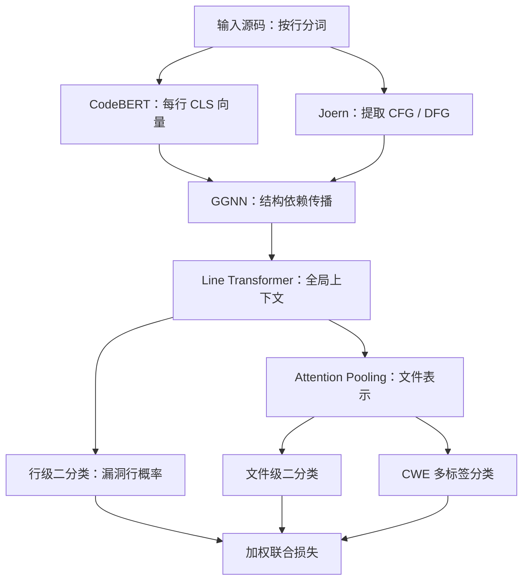

# CodeExplorer

**Structure-Aware Hierarchical Modeling for Line-Level Vulnerability Localization**

CodeExplorer 面向 C/C++ 源码中的行级漏洞定位，通过 **CodeBERT 行语义编码、CFG/DFG 结构传播、全局行级 Transformer 和多任务学习**，联合建模漏洞发生的位置、文件是否存在漏洞以及漏洞所属的 CWE 类别。


> **当前状态：研究代码，训练流程尚未完整接通。** 已包含主要模型组件、Juliet 元数据处理和训练/评测框架；缺少 `data.linevul_loader` 等必要接口。下文将可运行的预处理步骤与待接通的训练流程分别说明。论文结果为稿件报告值，本次没有重新训练或复现这些数值。

## 文档导航

| 文档 | 内容 |
| --- | --- |
| [目录与文件迁移](docs/repository-guide.md) | 各模块职责、逐文件迁移表、维护约定 |
| [论文与代码对照](docs/paper-and-code.md) | 方法设计、公式对应、论文实验结果和配置差异 |
| [数据格式与预处理](docs/data-format.md) | CSV 字段、Joern 图格式、数据集输出和训练批次约定 |
| [复现状态与待办](docs/reproduction-status.md) | 当前可用范围、训练阻塞项、评测缺口和验证记录 |

## 方法概览

漏洞可能由相隔较远的代码行共同触发，例如某处分支释放对象、另一处继续使用该对象。CodeExplorer 先理解单行语义，再沿程序依赖传播信息，最后用全局上下文和不同粒度的监督信号进行定位。



| 阶段 | 作用 | 实现位置 |
| --- | --- | --- |
| 行语义编码 | 独立编码每行 token，取 `[CLS]` 作为行向量 | [codebert_encoder.py](model/codebert_encoder.py) |
| 结构建模 | 沿控制流和数据流边聚合消息，通过 GRU 更新行表示 | [ggnn.py](model/ggnn.py)、[graph_builder.py](graph/graph_builder.py) |
| 全局上下文 | 用多层双向自注意力建模跨行交互 | [line_transformer.py](model/line_transformer.py) |
| 预测与监督 | 行级预测、注意力池化、文件级与 CWE 预测、加权损失 | [classification_heads.py](model/classification_heads.py)、[multitask_loss.py](model/multitask_loss.py) |
| 模型组合 | 串联上述组件，定义 `CodeExplorer.forward()` | [main.py](main.py) |

联合目标为：`L = lambda_line * L_line + lambda_file * L_file + lambda_cwe * L_cwe`。当前默认 `lambda_cwe=0`，且多任务开关未完整接入；论文描述的完整三任务设置需要另行对齐，见[差异说明](docs/paper-and-code.md)。

## 仓库结构

```text
codeExplore/
├── README.md
├── main.py                      # 模型组合与训练/评测入口
├── config.py                    # 数据路径、超参数、消融开关
├── requirements.txt             # 根据源码导入补充的直接依赖
├── pyproject.toml               # 原 Poetry 配置，依赖尚不完整
├── poetry.lock                  # 原始锁文件，保留供核对
├── poetry.toml                  # 原虚拟环境配置
├── data/                        # 数据读取与元数据处理代码
│   ├── __init__.py
│   ├── juliet_dataset.py        # JulietDataset，原 Build_JulietDataSet.py
│   ├── build_metadata.py        # 从 Juliet 注释构建行级标签
│   └── split_metadata.py        # 随机划分训练、验证和测试 CSV
├── graph/                       # 程序图及 Joern 接口
│   ├── __init__.py
│   ├── graph_builder.py         # 行级 PyG 图
│   ├── joern_utils.py           # 读取预导出的图 JSON
│   └── run_joern.py             # Joern 导出辅助函数
├── model/                       # 神经网络组件
│   ├── __init__.py
│   ├── codebert_encoder.py
│   ├── ggnn.py
│   ├── line_transformer.py
│   ├── classification_heads.py
│   └── multitask_loss.py
├── training/                    # 训练、验证和测试逻辑
│   ├── __init__.py
│   ├── train.py
│   └── evaluate.py
├── utils/                       # 指标、日志和绘图
│   ├── __init__.py
│   ├── metrics.py
│   ├── logger.py
│   └── visualization.py
└── docs/                        # 论文、数据与复现说明
```

`data/` 存放 Python 源码；本地原始数据建议放在 `datasets/`。缓存、日志、模型权重和数据目录已加入 `.gitignore`，不随代码提交。

## 环境准备

在仓库根目录运行以下命令：

```bash
git clone https://github.com/rrainy339-oss/codeExplore.git
cd codeExplore
python -m venv .venv
```

激活环境：Windows PowerShell 使用 `.venv\Scripts\Activate.ps1`；Linux/macOS 使用 `source .venv/bin/activate`。随后安装依赖：

```bash
python -m pip install -r requirements.txt
```

- `requirements.txt` 列出了源码直接使用的 PyTorch、PyTorch Geometric、Transformers、NumPy、pandas、scikit-learn、tqdm、Loguru 和 Matplotlib，**没有锁定论文环境版本**。
- 原 `pyproject.toml` 声明 Python `^3.13`，只声明 tqdm 和 pandas；`poetry install` 不能单独提供完整模型环境。原配置和锁文件暂时保留，避免伪造新的复现环境。
- GPU 实验需要匹配本机环境的 PyTorch；模型编码器还需要获得 `microsoft/codebert-base` 权重。
- 程序图抽取需要额外安装 Joern，并提供 `joern` 和 `joern-parse` 命令；仓库尚未记录可验证的 Joern 版本。
- 本次仅验证目录、源码语法和预处理流程，未验证完整模型依赖组合或 GPU 训练。

## Juliet 数据预处理

从仓库根目录以模块方式运行，路径可自行替换：

```bash
python -m data.build_metadata --source-root datasets/juliet/testcases --output-csv datasets/juliet/metadata/metadata.csv
python -m data.split_metadata --metadata datasets/juliet/metadata/metadata.csv --output-dir datasets/juliet/metadata --seed 42
```

默认按 **80% / 10% / 10%** 随机划分，生成 `metadata_train.csv`、`metadata_val.csv` 和 `metadata_test.csv`。样本数量受整数取整影响；输入样本过少时 scikit-learn 可能无法完成划分。可用以下命令查看参数：

```bash
python -m data.build_metadata --help
python -m data.split_metadata --help
```

元数据包含 `file_path`、`line_labels`、`file_label`、`cwe_label` 和 `project_name`。当前构建器仅扫描 `.c` 文件，依据 `bad` 函数中的 `FLAW` 注释启发式标记后续代码行，并跳过未找到漏洞标签的文件。因此生成的 CSV **不包含完整的文件级负样本**，也不包含论文所述去重和 AST 相似性过滤。具体限制与图数据准备方式见[数据说明](docs/data-format.md)。

## 训练与评测

`main.py` 保留 `--mode train` 和 `--mode evaluate --model_path ...` 两种入口，但**当前版本还不能直接完成训练或评测**。运行前至少需要补齐：

1. `data.linevul_loader.build_dataloader()`、变长样本补齐、图批处理和 CWE 标签映射。
2. CLI 与 `Config` 的参数对接：原入口传入的 `mode`、`model_path` 未在配置中声明，`project_split` 也缺失。
3. PyG 图对象的设备迁移、多任务开关、训练早停和完整评测指标的接入。

为避免把未完成的入口当作可用的快速开始，本页不提供“一条命令复现论文”的承诺。所需 batch 字段、修复位置和优先顺序见[复现状态](docs/reproduction-status.md)。

### 当前配置与论文设置

| 参数 | 当前 `Config` 默认值 | 论文 §4.2 |
| --- | --- | --- |
| 预训练编码器 | `microsoft/codebert-base`，隐藏维度 768 | CodeBERT |
| 学习率 | `2e-5` | `2e-5` |
| Batch size | `8` | `16` |
| GGNN 传播步数 / Transformer 层数 | `3` / `4` | 3 层 GNN / 4 层 Transformer |
| 随机种子 | `42` | `42` |
| 最大行数 / 每行 token 上限 | `400` / `128` | 稿件未给出具体值 |
| 训练轮数 / 早停 patience | `50` / `5` | 基于验证性能早停，代码尚未执行早停 |
| 损失权重（行 / 文件 / CWE） | `1.0 / 1 / 0` | 三任务加权联合，未给出权重数值 |

`JulietDataset` 自身的 `max_lines` 和 `max_tokens` 默认均为 `512`，尚未由数据加载器与 `Config` 对齐。

## 论文报告的结果

以下摘录自用户提供的论文草稿，百分比均为 **稿件报告值，未经本次运行验证**。

| 任务与数据 | 指标 | CodeExplorer | 稿件位置 |
| --- | --- | --- | --- |
| Juliet 行级定位 | Precision / Recall / F1 / Top-10 Recall | 79.8 / 78.3 / **79.0** / **83.4** | Table 2，第 7 页 |
| Juliet 文件级检测 | Accuracy / F1 / MCC | 87.4 / 86.8 / 0.749 | Table 3，第 7 页 |
| Juliet → Big-Vul 迁移 | Accuracy / 文件 F1 / Top-5 Recall / Top-10 Recall | 62.5 / 59.8 / 43.6 / 51.7 | Table 8，第 11 页 |

跨数据集实验是在 Juliet 训练后直接测试 Big-Vul，不进行微调。Big-Vul 的定位目标来自修复补丁中删除或修改的行，是代理标签；其 Top-k 指标不能直接等同于人工确认漏洞行的分类结果。更多基线和消融结果见[论文说明](docs/paper-and-code.md)。

## 引用与许可证

参考题名：*CodeExplorer: Structure-Aware Hierarchical Modeling for Line-Level Vulnerability Localization*。提供的 PDF 仍包含匿名作者、会议名和 DOI 占位符，暂不生成正式 BibTeX 或声称已在 ACM CCS 发表。论文 PDF 未随本次仓库整理加入版本控制。

当前仓库未提供 `LICENSE` 文件，本次保留这一状态，未新增许可证声明。
